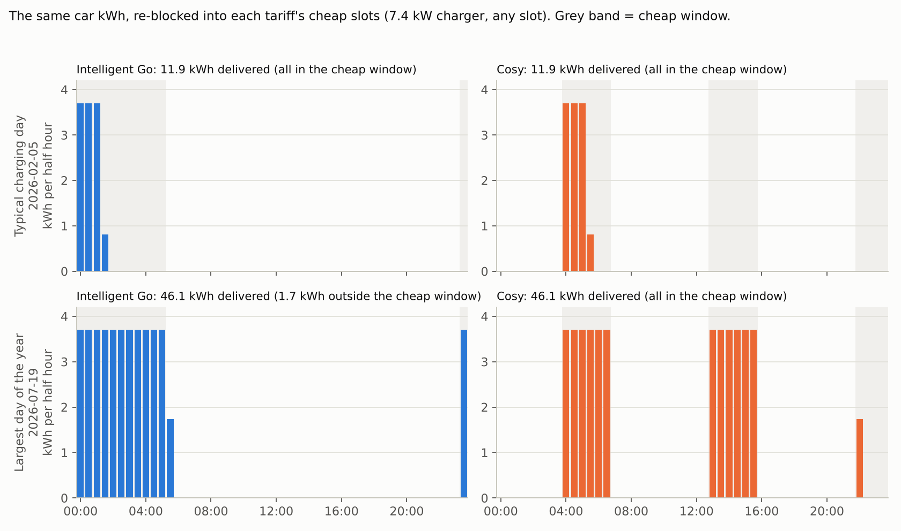
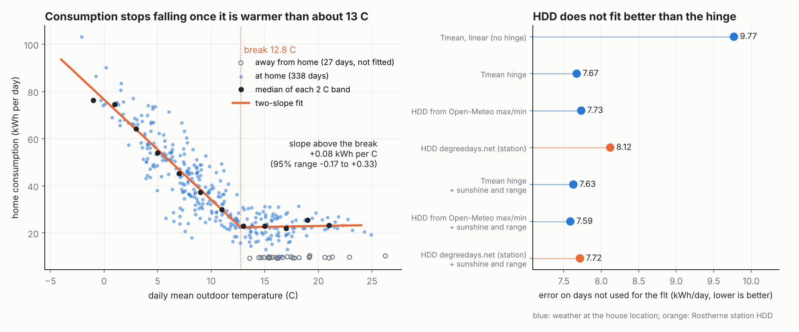
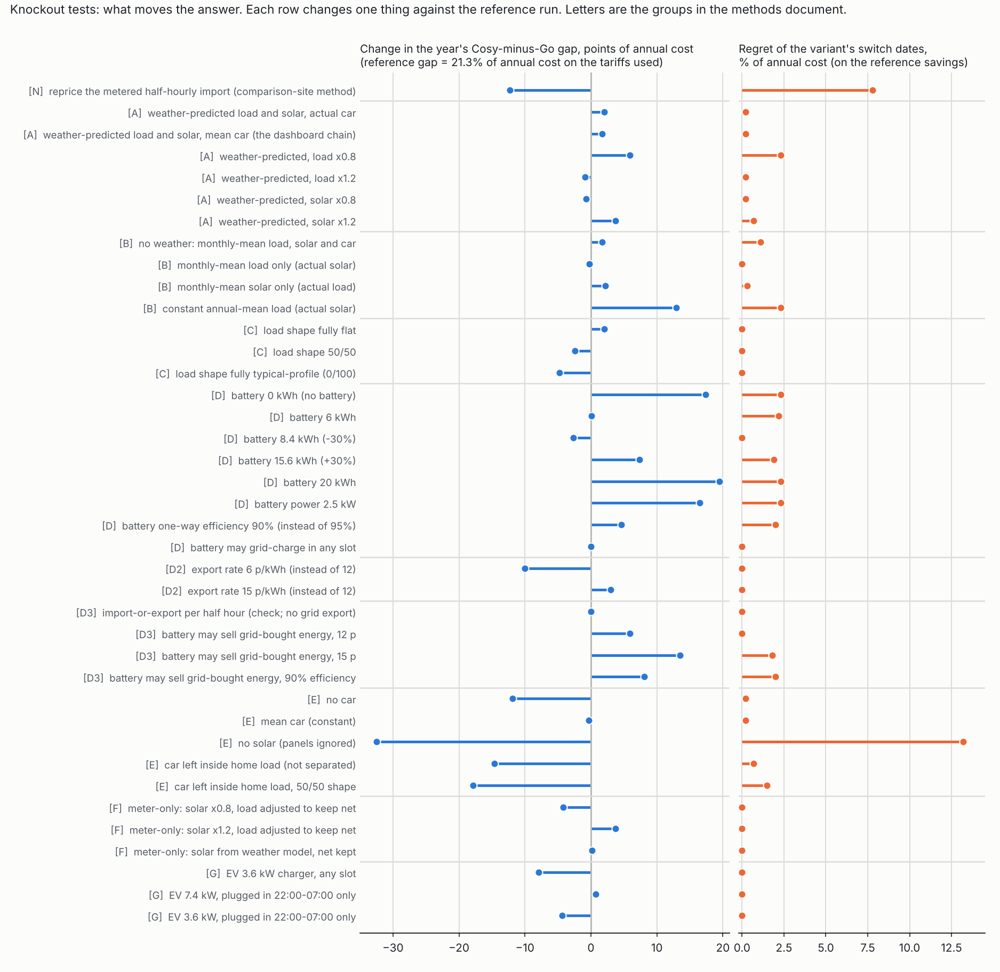

# Methods: the tariff-switch model

What the model does, how it handles the battery and the car, how it was tested, and where every number comes from.

Written 27 October 2026 for the posts on choosing between Octopus Cosy and Intelligent Go. Costs here are percentages, never pounds, and energy is in kWh. Every number is produced by a script in this repository; section 13 maps each claim to its script and output file, and section 14 says how to rerun them.

## Summary of findings

1. **The usual comparison would have given the dates I used, and they were not the best ones.** Repricing the half-hourly import the meter recorded on the other tariff (what comparison sites and the Octopus Compare app do) puts the best switch dates at 24 October and 6 April. I switched on 23 October and 5 April. Following those dates, or mine, costs 7.8% of the year's energy bill against the best dates in hindsight. The planner, fed only temperature and sunshine, picks 18 November and 8 February, which cost 7.6% less than mine over the year (staying on Go all year would have cost 5.2% less). The naive method fails because the metered import was shaped by the tariff it happened under: it prices the other tariff 40 to 48 points of the year's cost too high (section 9). This is one house and one year, in sample. The suggestion that other people will pick their dates the same way is my hypothesis, and what it rests on is that I did.
2. **Most of the details people argue about do not change the decision.** The battery, the solar and the car as separate quantities do. The within-day load shape, the grid-charging rule, the export price, a rough weather-based estimate of load and solar, how the car is limited by its charger, whether temperature enters as a hinge on the mean or as degree-days, and whether the solar has to be known exactly (only the meter's net flow matters) leave the dates within about two weeks and the regret within 0.3% of the year's cost. Section 8.5 sorts every test into the two groups.
3. **Letting the battery sell energy it bought from the grid is the one assumption that favours a tariff, and it favours Go.** At a flat 12 p export price Go gets 5.9 points of the year's cost cheaper and Cosy does not move, because Cosy's cheap rate (12.4 to 14.9 p) is above what a round trip can earn. The dates do not move at 12 p. At 15 p the autumn date moves to late February, which means staying on Go through the winter. Against the bills the unrestricted version overshoots what the house did, so the real battery is somewhere between (section 3.5).
4. **Degree-days do not fit this house's load better than the mean temperature.** On the 338 days someone was home the hinge on mean temperature, degree-days built from the same weather data and the Rostherne station's degree-days give R² of 0.80, 0.80 and 0.78. Load is flat above about 12.75 °C (section 7.1).

## 1. What the model answers, and what it does not

The question is: for this house, what would each day have cost on Cosy and on Intelligent Go, and so when was it worth switching?

The model answers it by re-planning each day for each tariff. It takes the day's actual home load, solar output and car charging, decides what a battery would do on that tariff's prices, moves the car's charging into that tariff's cheap slots, and adds the standing charge. Summing days gives a year on either tariff, or on any schedule of switches.

It does not forecast the weather or the future, it does not reproduce the bill to the penny, and it does not say what a real battery controller achieves: the planner sees the whole day in advance, so it is an upper bound on any real control. The weather-to-saving chain in section 7 is a separate, deliberately rougher layer built on top.

## 2. Inputs and where they come from

| Input | Source | Used for |
|---|---|---|
| Home load per day (`home_consumption_kwh`) | Tesla gateway, `data/daily_energy_weather.csv` | Load the battery plan must meet |
| Solar generated per day (`solar_generated_kwh`) | Same file | Solar available to the plan |
| Car and other load per day (`car_and_other_kwh`) | Same file: Octopus meter import minus gateway import, floored at zero. 4 days with an incomplete meter record take the median | Energy the car draws from the grid, outside the battery plan |
| Temperature and sunshine | Same file (Open-Meteo, modelled point values) | Weather chain only (section 7) |
| Rates and standing charges in force on each day | `data/tariff_rates_history.csv` (public prices, region G) | Pricing every slot |
| Half-hourly import and export | Octopus consumption exports, kept private | Only the optional checks in sections 9 and 10 |
| Billed energy cost | Octopus bills, kept private | Only the validation in section 10 |

Everything in the main results (sections 3 to 8) needs only the first five rows, which are public. The checks that need private files say so, and their output files are percentage-only.

Two caveats on the inputs. Home load is Tesla's "Home total", which includes about 1,200 kWh that Tesla files under "Charged" and that could not be separated. And the "car" figure is anything the meter saw that the gateway did not, so it is the car plus any other load outside the gateway; the model treats all of it as shiftable charging.

## 3. The day planner (battery)

### 3.1 Formulation

One day is 48 half-hour slots on the local clock. For each slot t the planner chooses five quantities, all in kWh per half hour: grid import g, battery charge c, battery discharge d, export e, and the battery's stored energy s at each slot boundary. It minimises

> total of (rate_t × g_t) − (export rate × e_t), over the 48 slots,

subject to:

1. **Energy balance in every slot:** g + d = (load − solar) + c + e. Whatever the house needs, plus what goes into the battery or out to the grid, is met by import, discharge and solar.
2. **Battery state:** s(t+1) = s(t) + 0.95 × c − d / 0.95. The 95% is applied on the way in and on the way out, so a full cycle returns about 90%.
3. **Capacity and power:** 0 ≤ s ≤ 12 kWh; c and d each at most 5 kW × 0.5 h = 2.5 kWh per slot.
4. **Start equals end:** the battery finishes the day with the same stored energy it started with, whatever that value is. Days are independent, with no carry-over of an overnight charge into the next day.
5. **Grid charging only in the cheap window:** in slots outside the tariff's cheapest-rate slots, import cannot exceed the home's net load, so the grid cannot fill the battery there. Inside the window import is effectively unrestricted (30 kWh per slot).
6. **Export is limited to that slot's solar:** e ≤ solar in the same half hour. The battery can therefore make solar go further by covering the load, but it never exports energy it bought from the grid.

This is a linear programme with 241 variables, solved by HiGHS through `scipy.optimize.linprog` in about 5 ms per day, so a year on two tariffs takes seconds. The code is `switch_model/sim.py`.

The day's load and solar are spread across the 48 slots by two fixed shapes:

* **Load shape:** 80% of the day's kWh is spread evenly and 20% follows a typical household profile (low overnight, a morning bump, a larger evening peak). The 80/20 split is an assumption: the profile is a guess, which is why section 8 tests it.
* **Solar shape:** proportional to sin(elevation)^1.2 for the day of the year at 53.53°N, zero at night, with solar noon at 12:10 UTC.

### 3.2 Parameters

| Parameter | Value | Where set |
|---|---|---|
| Usable battery capacity | 12 kWh (assumed; not read from the device) | `tariffs.py` `BATTERY_KWH` |
| Charge and discharge power | 5 kW | `POWER_KW` |
| One-way efficiency | 95% | `EFFICIENCY` |
| Flat share of the load shape | 80% | `FLAT_LOAD` |
| Export price | 12 p/kWh for the whole year | `EXPORT_RATE` |
| Minimum stored energy (reserve) | 0 | `sim.py` default |

### 3.3 Modelling choices, their effect, and whether they were tested

| Choice | Likely effect on the answer | Tested? |
|---|---|---|
| The planner knows the whole day in advance | Costs lower than a real controller can achieve; applies to both tariffs | Not tested. Section 7 tests errors in the load and solar inputs, not errors in a controller's foresight |
| Days are independent, start and end charge equal | Neutral over a long run; ignores a battery that starts a day low after a poor one | Not tested |
| 12 kWh, 5 kW, 95% | Size and power drive the result strongly | Yes, group D |
| Grid charging only in the cheap window | None found | Yes, group D |
| Export capped at that slot's solar | The real Powerwall also exported grid-bought energy from April to September (an estimated 818 kWh over the year, see `DATA_DICTIONARY.md`). Allowing it favours Go and not Cosy | Yes, group D3 and section 3.5. 12 p leaves the dates unchanged; 15 p moves the autumn date to late February. Unrestricted, it overshoots what the house did |
| Load shape 80% flat | None on the verdict (switch dates unchanged for fully flat) | Yes, group C |
| Export price fixed at 12 p | Billing used 15 p until February 2026 and 12 p after, so the model understates export income early on | Yes, group D2: 15 p leaves the dates unchanged |
| Car priced outside the battery plan at the cheapest rate | Exact when the cheap window has room; see section 5 | Yes, group G |
| Solar shape sin(elevation)^1.2 | Affects only the timing of solar within a day | Not tested separately |
| No import or export power limit at the meter, no battery wear or self-discharge | Small | Not tested |
| 48 slots on every day, including the two clock-change days | Negligible | Not tested |

### 3.4 Two worked days

The numbers below come from `switch_model/sim.py` for the days named, using the day's actual load and solar and the rates in force. Battery, import and export columns are the planner's and exclude the car. "Cost" is the whole day on that tariff including the car and the standing charge, as a percentage of an average day's cost on the tariffs actually used; a negative cost means the day earned money.

| Day | Tariff | Load / solar (kWh) | Battery charged (kWh) | Battery discharged (kWh) | Grid import (kWh) | Export (kWh) | Cost (% of average day) |
|---|---|---|---|---|---|---|---|
| 5 Feb 2026 (winter) | Cosy | 61.2 / 3.8 | 35.3 | 31.8 | 60.8 | 0.0 | 387 |
| 5 Feb 2026 (winter) | Intelligent Go | 61.2 / 3.8 | 12.6 | 11.4 | 58.6 | 0.0 | 395 |
| 10 May 2026 (spring) | Cosy | 33.2 / 57.6 | 9.3 | 8.4 | 5.8 | 29.3 | -68 |
| 10 May 2026 (spring) | Intelligent Go | 33.2 / 57.6 | 12.6 | 11.4 | 20.3 | 43.5 | -95 |

Two things show in the table. On Cosy in winter the battery cycles about three times in a day, topping up in each of the three cheap windows (12.6 kWh at 04:00 to 07:00, 12.6 kWh at 13:00 to 16:00, 10.0 kWh at 22:00 to midnight), because each window refills what the preceding dear period drained. On Go it cycles once, in the 23:30 to 05:30 window. And on a sunny spring day the Go battery fills from the grid overnight at the night rate and runs the house through the day, which leaves more of the roof's output to be exported (43.5 kWh against 29.3 on Cosy); on Cosy the cheap rate (12 to 15 p) is too close to the 12 p export price for that to pay, and at least 6.8 of the 9.3 kWh the battery took in came from solar, since the planner can only charge from the grid in the cheap window.

### 3.5 Exporting energy bought from the grid

**What was asked.** A battery can be run to buy energy when it is cheap and sell it back when the export price is high. For a battery-only house on a tariff with a high evening export price (Intelligent Flux is the usual example) that is standard practice: the Powerwall does it on its own algorithm and Predbat and Netzero automate it. For a house with solar on Cosy or Go it is a deliberate trick, either to cycle the battery once more a day or to buy cheap and sell dear. It is not what the planner does by default, and section 3.3 originally said it was not tested. It now is.

**How it is modelled.** `sim.solve_day(..., export_grid=True)` solves a small mixed-integer programme instead of the linear one. Each half hour gets a binary that says whether it is an import half hour or an export half hour, never both, because a meter nets the flow within the half hour. Export is then limited to that half hour's solar plus the inverter's discharge limit (5 kW), instead of to the solar alone. Unneeded solar can be curtailed. The export price may be a single number or 48 half-hourly values, so a time-varying export tariff can be modelled. A first attempt that left out the binary let the optimiser import and export in the same half hour and collect the price difference, which is why the binary is needed. Two further options exist: `xor=True` applies the import-or-export rule while keeping export limited to the solar, and `cycles=c` caps the energy drawn from the battery at c times its capacity in a day. The default is unchanged and is still the linear programme that every other number in this document uses. A day takes about 0.1 to 0.4 seconds, a year on one tariff about 1 to 2 minutes.

**Check 1: the new solver agrees with the old one when it should.** With export still limited to solar, the import-or-export version gives the same year as the default at a 12 p export price: Cosy 116.1% and Go 94.8% in both (the Go year differs by 0.01%: on 68 days from mid-May to late July the 05:00 to 05:30 half hour is inside Go's cheap window and has a little solar, so the linear programme can import and export in it; the gap rounds to 21.2 against 21.3). It matters for a high export price: at 15 p the default linear programme can import cheaply and export in the same half hour when the cheap import rate is below 15 p, which on Cosy it is (12.35 to 14.95 p) in the 13:00 to 16:00 window, when there is solar. The group D2 row for 15 p therefore uses the import-or-export version, and Cosy is 103.0% in place of the 101.7% an earlier run of this document gave. No other number changed.

**Check 2: synthetic prices.** On a made-up day (no solar, small load, import 15 p overnight, export 30 p from 16:00 to 19:00; these are not real tariff rates) the planner charges 12.6 kWh overnight and exports 9.8 kWh in the evening, and costs less than the day without grid export. This confirms the machinery, nothing about any real tariff.

**Result on this house** (percentages of the reference's annual cost on the tariffs used; `data/knockout_percent.csv`, group D3):

| Variant | Cosy % | Go % | Gap % | Gap change (pts) | Switch dates | Regret % |
|---|---|---|---|---|---|---|
| reference (export limited to solar, 12 p) | 116.1 | 94.8 | 21.3 | +0.0 | 22 Nov / 10 Feb | 0.0 |
| import-or-export only, no grid export (check 1) | 116.1 | 94.8 | 21.2 | -0.0 | 22 Nov / 10 Feb | 0.0 |
| battery may export grid-bought energy, 12 p | 116.1 | 88.9 | 27.2 | +5.9 | 22 Nov / 10 Feb | 0.0 |
| same, export 15 p | 102.1 | 67.4 | 34.7 | +13.5 | 26 Feb / 10 Feb | 1.8 |
| same, 12 p, battery efficiency 90% | 126.1 | 96.7 | 29.4 | +8.1 | 28 Feb / 05 Feb | 2.0 |

**Reading it.**

* The gain is on Go. At 12 p export, a round trip returns 12 × 0.95 × 0.95 = 10.8 p for each pence of energy bought, and Go's night rate (5.2 to 8.0 p) is well below that, so there is a margin of 3 to 6 p per kWh. Cosy's cheap rate (12.35 to 14.95 p) is above it, so there is no margin and Cosy does not move. Go's year falls by 5.9 points of the year's cost, from 94.8% to 88.9%, and the gap widens from 21.3 to 27.2 points.
* At 12 p the switch dates do not move (22 November and 10 February) and the regret is zero. The decision is the same; Go is simply worth more.
* At 15 p the gap widens to 34.7 points and Go's year falls to 67.4%, and the best autumn date is now 26 February, in practice staying on Go through the winter. The regret of 1.8% is what following the model's grid-export dates would cost if the reference (no grid export) were the truth. The 90% efficiency row does not isolate grid export: efficiency 90% on its own already moves the autumn date to 26 February with 2.0% regret (group D), so the date in that row comes mostly from the efficiency.
* The battery used for its own purposes comes first. On sample days it exports only a few kWh, because the stored energy is worth more offsetting the house's own load at the dear rate than exported.

**Check 3: against what the house did.** With unrestricted grid export, the planner's net cost on Go days is 5.3% of the year's billed total below the bills (it is 1.2% below without grid export), the mean absolute daily error rises from 8.0% to 11.1% of an average day, and the planner imports 9.2 kWh a day more than the gateway recorded and exports 7.5 kWh a day more (1.5 and 0.7 without; `data/planner_validation_gridexport_percent.csv`). The unrestricted version therefore overshoots what the house's Powerwall did, which was an estimated 818 kWh of grid-bought export over six months. The truth lies between the two. Cosy days are unaffected (1.1% in both).

**What it means.** If your battery can sell energy it bought and your export tariff pays enough, Go is worth more than the default model says, by up to about 6 points of the year's cost at 12 p, and the case for staying on it through the winter gets stronger. If it cannot, nothing changes. This is why the model's battery-export setting is an input and not a hidden assumption. Intelligent Flux, where the evening export price is high enough to make this standard, is not in the rate history used here and is left to the general tool (post 3).

## 4. Tariffs and rates

Each tariff is a 48-slot price curve plus a standing charge, built by `switch_model/tariffs.py` from the rate history for the date in question.

* **Cosy:** cheap 04:00 to 07:00, 13:00 to 16:00 and 22:00 to 24:00 (16 half hours in three windows); peak 16:00 to 19:00; standard rate otherwise.
* **Intelligent Go:** cheap 23:30 to 05:30 (12 half hours in one window); one day rate otherwise.
* **Rates in force:** the main analysis prices each day at the rates in force on that date, because Cosy and Go rates changed several times in the year and a switch date can only be judged against the prices of that moment. Go is the variable product (INTELLI-VAR-24-10-29) before 5 April 2026 and the 12-month fixed product (INTELLI-FIX-12M-26-03-23, the one actually taken) from 5 April 2026. The 27 October 2026 prices (`TARIFFS`, `COSY_FIXED`) are used only for the forward-looking fixed-versus-flexible Cosy example.
* **Standing charges** are added daily and are the same in every variant, so they never decide a switch within a variant but do enter the cost totals.

## 5. The car

### 5.1 What the model does

The car is not part of the battery plan. Its daily kWh is treated as an amount of energy that must be delivered, and the model decides when:

1. For each day, the car's kWh is placed into the cheapest slots of the tariff being priced, cheapest first, at no more than charger power × 0.5 h per slot (7.4 kW gives 3.7 kWh per slot).
2. Ties are broken by taking the earliest slot of the day, so a day's charge lands at the start of the first cheap window.
3. Within a day the kWh delivered is conserved: the allocation sums to the day's measured car kWh, and the code asserts this on every day, tariff and scenario (`alloc` in `switch_model/knockout.py`).
4. Because cost is linear in kWh and the per-slot cap is a fixed number, filling the cheapest slots first is the exact optimum, not a heuristic.

This is what turns a car charge that was shaped by one tariff into the right charge on another. On Intelligent Go the car sits in the 23:30 to 05:30 block; priced on Cosy, the same kWh is split across Cosy's three windows; priced on Go again, it returns to one block. The measured profile is never used, only the total kWh.



*A typical charging day (11.9 kWh) and the largest day of the year (46.1 kWh), re-blocked onto each tariff at 7.4 kW. On the large day Cosy's 16 cheap half hours take all of it, while Go's 12 do not quite (1.7 kWh spills into the next dearest slot).*

### 5.2 When the shortcut is exact, and when it is not

The reference run prices the car at each tariff's cheapest rate. That is identical to full re-blocking only when the cheap window can absorb the day's kWh. The capacity is 12 half hours (Go) or 16 (Cosy), so:

| Charger | Go window holds | Cosy windows hold |
|---|---|---|
| 7.4 kW | 44.4 kWh a day | 59.2 kWh a day |
| 3.6 kW | 21.6 kWh a day | 28.8 kWh a day |

The car charged on 150 days of the year (more than 0.5 kWh); the median of those days was 11.9 kWh and the largest 46.1 kWh. On a 7.4 kW charger only one day exceeds Go's window; on a 3.6 kW charger 48 days exceed Go's window and 32 exceed Cosy's. Charger power and plug-in habits therefore matter, and the model takes both as inputs. When a day's kWh does not fit the allowed slots, the overflow goes into the cheapest remaining slots anywhere. That keeps the kWh whole, but it assumes the car can charge outside the stated plug-in window, so it flatters tight limits.

Car charging under charger-power and plug-in limits, over the year's 2,164 kWh (`data/ev_reblocking_percent.csv`). Overflow is days when the allowed slots could not hold the day's kWh. Every scenario delivers the same 2,164.3 kWh.

| Scenario | Cosy: extra cost over cheapest rate (% of base) | Cosy: days overflowing | Cosy: kWh in dearer slots | Go: extra cost over cheapest rate (% of base) | Go: days overflowing | Go: kWh in dearer slots | Gap change (pts) |
|---|---|---|---|---|---|---|---|
| any slot 7.4 kW | 0 | 0 | 0 | 0 | 0 | 1.7 | -0 |
| any slot 3.6 kW | 3 | 0 | 254 | 10.9 | 0 | 512.8 | -7.9 |
| plugged in 22:00-07:00, 7.4 kW | 0.7 | 0 | 59.4 | 0 | 0 | 1.7 | 0.7 |
| plugged in 22:00-07:00, 3.6 kW | 6.5 | 24 | 539.3 | 10.9 | 24 | 512.8 | -4.4 |

Reading the table: with a 7.4 kW charger that can charge any time, the cheapest-rate shortcut is exact for Cosy and misses 1.7 kWh on one Go day. At 3.6 kW the car's extra cost over the cheapest rate is 10.9% of the annual cost on Go but 3.0% on Cosy, because Go's single block is shorter, and that narrows the year's Cosy-minus-Go gap by 7.9 points. Allowing the car to charge only between 22:00 and 07:00 at 7.4 kW costs Cosy 0.7%, because Cosy's afternoon window is out of reach.

### 5.3 What the car handling does not capture

It does not model Octopus's smart-charging dispatch decisions on Go, the car's state of charge, a charging deadline, or charging directly from solar (the car's energy is all grid import, as the metering implies). It does not separate the car from other load outside the gateway. Group E shows how much the car's treatment matters: leaving it inside the home load moves the year's Cosy-minus-Go gap by 14.6 points.

## 6. From days to a verdict

* **Cost of a schedule:** the sum of each day's cost on whichever tariff the schedule has you on that day. Post 2's baseline, the dates actually used, is Go to 22 October, Cosy from 23 October, Go again from 5 April.
* **Saving:** Cosy cost minus Go cost for each day, so a positive saving means Go was cheaper.
* **Hindsight-best switch:** for each switch, the date in a window that maximises the gain over staying put (autumn: 21 October to 28 February, Go to Cosy; spring: 1 February to 30 June, Cosy to Go). For the pair of dates jointly, `analysis.py` searches all combinations.
* **Regret:** what following a date cost relative to the best date, evaluated on the reference savings and expressed as a percentage of the annual cost on the tariffs used.
* **Sensitivity:** how much dearer the year is when both best dates move together by k days (`data/switch_sensitivity_percent.csv`). Moving them by 7 days costs 0.5 to 0.6%, by 14 days 0.7 to 1.0%, by 28 days 2.7 to 3.7%, and by 42 days 4.7 to 5.7%.

Results for the dates actually used, against the best in hindsight: autumn regret 2.7% and spring regret 5.1% of the annual cost, hindsight dates 22 November and 10 February. These regrets are in sample: the dates are chosen with the whole year known, so they show what was available, not what could have been predicted.

## 7. The weather chain

The chain predicts a day's load and solar from temperature and sunshine alone, then feeds them to the same planner.

* **Solar:** clear-sky output by day of year multiplied by a cloud factor from the share of daylight that was sunny. Four parameters fitted by least squares: R² 0.90 on daily solar.
* **Home load:** a + b × heating-degree-days + c × heating-degree-days × sunshine share + d × temperature range, with the balance point chosen by grid search (13.5 °C). R² 0.81 on daily load.
* **Parameters:** solar [35.40, 26.64, 0.316, 1.821]; load [22.70, 4.231, -0.320, -0.384]; balance point 13.5 °C. `switch_model/model.py` `fit_chain` reproduces these from the public CSV to three or four decimals.

How good is the chain? Using weather-predicted load and solar and a constant mean car in place of the real values (row A in section 8): daily savings agree with the reference with a mean error of 18% of an average day, the 7-day mean saving correlates at 0.90 and agrees in sign 94% of the time, and the hindsight dates move from 22 November and 10 February to 18 November and 8 February, which costs 0.2% of the annual cost.

### 7.1 Degree-days or mean temperature?

A reader suggested using heating-degree-days (HDD) instead of the daily mean temperature for the plot of the home's consumption against outdoor temperature, which shows consumption flat above about 12.5 °C. The chain already fits a hinge on the mean temperature (load rises in proportion to how far the mean is below a balance point and does not change above it), which is a degree-day model computed from the daily mean. The question tested here is whether a different way of computing degree-days fits better. `switch_model/hdd_fit.py` compares them on the 338 days someone was home (the 27 away days, 22 July to 17 August, sit at the house's standby load whatever the weather and are left out of these fits), by least squares, with 10-fold cross-validation repeated 20 times and the base temperature chosen inside each training fold (`data/hdd_vs_mean_temperature.csv`).



| Representation | Terms | Base (°C) | R² | RMSE (kWh/day) | Cross-validated RMSE (kWh/day) |
|---|---|---|---|---|---|
| Tmean, linear (no hinge) | single term | none | 0.681 | 9.68 | 9.77 |
| Tmean hinge | single term | 12.75 | 0.804 | 7.60 | 7.67 |
| HDD from Open-Meteo max/min | single term | 12.5 | 0.800 | 7.68 | 7.73 |
| HDD degreedays.net (station) | single term | 14 | 0.780 | 8.05 | 8.12 |
| Tmean hinge | + sunshine and range | 12.5 | 0.809 | 7.49 | 7.63 |
| HDD from Open-Meteo max/min | + sunshine and range | 12.5 | 0.810 | 7.48 | 7.59 |
| HDD degreedays.net (station) | + sunshine and range | 13 | 0.804 | 7.59 | 7.72 |

* **Flat above the break is confirmed.** Fitting a separate slope below and above a break gives a break at 12.75 °C, 4.25 kWh per degree below it, and +0.08 kWh per degree above it, with a 95% bootstrap range of −0.17 to +0.33, so a slope of zero is inside it (`data/hdd_two_slope_test.csv`). The reader's 12.5 °C is right to within the resolution of the data.
* **HDD does not fit better.** Degree-days from the same weather data score 0.80 against 0.80 for the hinge on the mean, and differ by 0.06 kWh a day in cross-validated error. The station degree-days (Rostherne No 2, about 19 km from the house, hourly based) fit slightly worse, 0.78 and a cross-validated error of 8.12 against 7.67 kWh a day, and their best base is 14 °C. The most likely reason is location: the weather inputs are modelled values for the house's own grid cell, and the station is somewhere else. This was not tested separately.
* **A straight line is clearly worse** (R² 0.68, error 9.77), which is the real reason to use either a hinge or degree-days. Adding the sunshine and range terms the chain uses improves the cross-validated error by 0.04 to 0.15 kWh a day for the two variants built on the house's own weather and by 0.4 for the station degree-days, which is the one that gains most from the extra terms.
* **Away days matter more than the temperature representation.** The chain as published was fitted to all 365 days, away days included, and its balance point is 13.5 °C. Fitted to the at-home days only, the best base is 12.5 °C, and the predicted costs rise by 3.8 and 3.2 points for Cosy and Go (116.3% and 92.7% against the reference's 116.1% and 94.8%). The switch dates (18 November and 8 February) and the regret (0.2%) do not change (`data/hdd_switch_effect_percent.csv`).

| Load model feeding the weather chain | Cosy % | Go % | Gap change (pts) | Switch dates | Regret % |
|---|---|---|---|---|---|
| chain as published: hinge on mean temperature, all 365 days, base 12-19 C | 112.5 | 89.5 | +1.7 | 18 Nov / 08 Feb | 0.2 |
| hinge on mean temperature, at-home days only | 116.3 | 92.7 | +2.3 | 18 Nov / 08 Feb | 0.2 |
| hinge on mean temperature, at-home days only, single term (no sunshine, range) | 115.9 | 92.1 | +2.6 | 18 Nov / 08 Feb | 0.2 |
| degreedays.net station HDD, at-home days only | 116.3 | 91.8 | +3.2 | 14 Dec / 08 Feb | 0.6 |

So for the decision it makes no difference which is used. The station degree-days move the autumn date by nearly a month (14 December against 18 November), at 0.6% regret, which is the flat bottom of the autumn gain curve (section 6) and not a structural change. The published numbers keep the original chain. Refitting on at-home days only would be a small improvement in levels and would be the right choice for a new version. The HDD file is not in the repository: degreedays.net's data are for the user to download (`--hdd` argument).

## 8. Knockout tests

### 8.1 Design

A knockout test changes one thing about the model and measures what moves. The reference is the run described above with the day's actual load, solar and car. Every other row replaces or degrades one input or assumption, reruns the full year on both tariffs, and compares with the reference. Costs are percentages of the reference's annual cost on the tariffs actually used (the "base"); "an average day" is the base divided by 365.

Measures, per variant:

| Measure | Meaning |
|---|---|
| `cosy_pct`, `go_pct` | Year on each tariff, % of base |
| `saving_pct` | Cosy minus Go; positive means Go is cheaper |
| `d_saving_pct` | Change in that gap against the reference, in points of base |
| `day_MAE_pct` | Mean absolute error of the daily saving, % of an average day |
| `sign7`, `corr7` | Share of days on which the 7-day mean saving has the same sign as the reference, and its correlation with the reference's |
| `switch_dates` | Hindsight-best autumn and spring switch dates according to the variant |
| `regret_pct` | What following those dates costs, evaluated on the reference savings, % of base |

Dates of 28 Feb or 1 Feb are the edges of the search windows: they mean the variant found no interior optimum and would never, or immediately, switch. Many of the regrets of 2.3% are of this kind.

### 8.2 The variants and why each was run

| Group | Variants | What it asks |
|---|---|---|
| N | Reprice the metered half-hourly import (the comparison-site method) | How wrong is the standard approach? Section 9 |
| A | Weather-predicted load and solar (with the real car and with a mean car); the prediction scaled ±20% | Does the answer survive using the weather instead of the meter, and errors in the fit? |
| B | Monthly-mean load and solar, load only, solar only; constant annual mean load | How much weather information is needed, and which of load or solar matters more? |
| C | Load shape fully flat, 50/50, fully typical | Does the unknowable within-day shape matter? |
| D | Battery 0, 6, 8.4, 15.6, 20 kWh; power 2.5 kW; efficiency 90%; no grid-charging window rule | How much do battery assumptions matter? |
| D2 | Export price 6 p and 15 p (solved with the import-or-export rule, section 3.5) | How sensitive is the answer to the export price? |
| D3 | Import-or-export check; battery allowed to export energy bought from the grid at 12 p and 15 p, and at 90% efficiency | Does selling grid-bought energy change the verdict? Section 3.5 |
| E | No car; constant mean car; no solar; car left inside the home load, with the standard and a 50/50 shape | What if the car or solar is unknown or not separated? |
| F | Meter-only: solar scaled ±20% or taken from the weather model, with the load adjusted so that load minus solar (what the meter sees) is unchanged | What if only the smart-meter net flow is known and the solar is estimated? |
| G | EV limited to a 3.6 kW charger, or plugged in only 22:00 to 07:00 | Section 5.2, run through the whole verdict |

### 8.3 Results



All figures are percentages of the reference's annual cost on the tariffs actually used (`data/knockout_percent.csv`). Gap is Cosy minus Go.

| Group | Variant | Cosy % | Go % | Gap % | Gap change (pts) | Daily error % | Sign7 | Corr7 | Switch dates | Regret % |
|---|---|---|---|---|---|---|---|---|---|---|
| N | NAIVE: reprice the metered half-hourly import (comparison-site method) | 155.2 | 146.2 | 9 | -12.3 | 88.5 | 0.77 | 0.52 | 24 Oct / 06 Apr | 7.8 |
| ref | reference (actual load, solar, car; 12 kWh; shape 80/20) | 116.1 | 94.8 | 21.3 | 0 | 0 | 1 | 1 | 22 Nov / 10 Feb | 0 |
| A | weather-predicted load and solar, actual car | 112.6 | 89.3 | 23.3 | 2 | 7.1 | 0.96 | 0.97 | 14 Nov / 06 Feb | 0.2 |
| A | weather-predicted load and solar, mean car (the weather chain) | 112.4 | 89.5 | 23 | 1.7 | 18.1 | 0.94 | 0.9 | 18 Nov / 08 Feb | 0.2 |
| A | weather-predicted, load x0.8 | 74.9 | 47.8 | 27.2 | 5.9 | 19.5 | 0.83 | 0.83 | 28 Feb / 01 Feb | 2.3 |
| A | weather-predicted, load x1.2 | 153.5 | 133 | 20.4 | -0.9 | 18.7 | 0.96 | 0.88 | 14 Nov / 21 Feb | 0.2 |
| A | weather-predicted, solar x0.8 | 132.7 | 112.1 | 20.5 | -0.7 | 18 | 0.94 | 0.88 | 14 Nov / 21 Feb | 0.2 |
| A | weather-predicted, solar x1.2 | 92.5 | 67.6 | 25 | 3.7 | 18.8 | 0.93 | 0.89 | 15 Dec / 08 Feb | 0.7 |
| B | no weather: monthly-mean load, solar and car | 113 | 90 | 23 | 1.7 | 19 | 0.91 | 0.86 | 01 Dec / 01 Mar | 1.1 |
| B | monthly-mean load only (actual solar) | 114 | 93 | 21.1 | -0.2 | 6.3 | 0.95 | 0.95 | 22 Nov / 14 Feb | 0 |
| B | monthly-mean solar only (actual load) | 115.3 | 91.8 | 23.5 | 2.2 | 7.4 | 0.97 | 0.95 | 16 Nov / 05 Feb | 0.3 |
| B | constant annual-mean load (actual solar) | 100.6 | 66.4 | 34.2 | 12.9 | 15.5 | 0.78 | 0.82 | 28 Feb / 01 Feb | 2.3 |
| C | load shape fully flat | 114.4 | 91.2 | 23.3 | 2 | 2 | 0.97 | 1 | 22 Nov / 10 Feb | 0 |
| C | load shape 50/50 | 119.2 | 100.3 | 18.9 | -2.4 | 2.4 | 0.98 | 1 | 14 Nov / 14 Feb | 0 |
| C | load shape fully typical-profile (0/100) | 126.3 | 109.8 | 16.5 | -4.8 | 4.8 | 0.97 | 0.99 | 14 Nov / 14 Feb | 0 |
| D | battery 0 kWh (no battery) | 196.5 | 157.9 | 38.6 | 17.4 | 39.3 | 0.73 | -0.32 | 28 Feb / 01 Feb | 2.3 |
| D | battery 6 kWh | 138 | 116.6 | 21.4 | 0.1 | 13.2 | 0.82 | 0.68 | 26 Feb / 02 Feb | 2.2 |
| D | battery 8.4 kWh (-30%) | 125.8 | 107.2 | 18.5 | -2.7 | 6.5 | 0.94 | 0.96 | 22 Nov / 10 Feb | 0 |
| D | battery 15.6 kWh (+30%) | 111.9 | 83.2 | 28.7 | 7.4 | 7.4 | 0.88 | 0.96 | 28 Feb / 10 Feb | 1.9 |
| D | battery 20 kWh | 111.2 | 70.4 | 40.8 | 19.5 | 19.5 | 0.78 | 0.7 | 28 Feb / 01 Feb | 2.3 |
| D | battery power 2.5 kW | 132.5 | 94.8 | 37.7 | 16.5 | 16.5 | 0.78 | 0.25 | 28 Feb / 01 Feb | 2.3 |
| D | battery one-way efficiency 90% (instead of 95%) | 126.1 | 100.2 | 25.9 | 4.6 | 5.6 | 0.86 | 0.96 | 26 Feb / 05 Feb | 2 |
| D | battery may charge from the grid in any slot (no window rule) | 116.1 | 94.8 | 21.3 | -0 | 0 | 1 | 1 | 22 Nov / 10 Feb | 0 |
| D2 | export rate 6 p/kWh (instead of 12) | 133.1 | 121.9 | 11.2 | -10 | 10 | 1 | 0.92 | 22 Nov / 10 Feb | 0 |
| D2 | export rate 15 p/kWh (instead of 12) | 103 | 78.7 | 24.3 | 3 | 3.2 | 1 | 0.99 | 22 Nov / 10 Feb | 0 |
| D3 | import-or-export per half hour (solar-only export, as the default otherwise) | 116.1 | 94.8 | 21.2 | -0 | 0 | 1 | 1 | 22 Nov / 10 Feb | 0 |
| D3 | battery may export energy bought from the grid (12 p flat export) | 116.1 | 88.9 | 27.2 | 5.9 | 5.9 | 0.95 | 1 | 22 Nov / 10 Feb | 0 |
| D3 | battery may export grid-bought energy, export 15 p | 102.1 | 67.4 | 34.7 | 13.5 | 13.5 | 0.91 | 0.98 | 26 Feb / 10 Feb | 1.8 |
| D3 | battery may export grid-bought energy, efficiency 90% | 126.1 | 96.7 | 29.4 | 8.1 | 8.1 | 0.83 | 0.97 | 28 Feb / 05 Feb | 2 |
| E | no car | 90.4 | 81.1 | 9.3 | -11.9 | 11.9 | 0.95 | 0.9 | 14 Nov / 21 Feb | 0.2 |
| E | mean car (constant) | 115.9 | 94.9 | 20.9 | -0.3 | 16.5 | 0.96 | 0.92 | 22 Nov / 21 Feb | 0.2 |
| E | no solar (panels ignored) | 222.7 | 233.9 | -11.2 | -32.5 | 33.3 | 0.51 | 0.42 | 02 Nov / 25 Jun | 13.2 |
| E | car left inside home load (not separated) | 123.3 | 116.6 | 6.7 | -14.6 | 14.6 | 0.9 | 0.8 | 11 Nov / 21 Feb | 0.7 |
| E | car left inside home load, 50/50 shape | 127.3 | 123.9 | 3.4 | -17.9 | 17.9 | 0.88 | 0.78 | 11 Nov / 03 Mar | 1.5 |
| F | meter-only: solar x0.8, load adjusted to keep net | 115.2 | 98.1 | 17.1 | -4.2 | 4.3 | 0.98 | 1 | 14 Nov / 14 Feb | 0 |
| F | meter-only: solar x1.2, load adjusted to keep net | 117.6 | 92.6 | 24.9 | 3.7 | 3.8 | 0.97 | 1 | 22 Nov / 10 Feb | 0 |
| F | meter-only: solar from weather model, net kept | 116.3 | 94.8 | 21.4 | 0.2 | 4.3 | 0.99 | 0.99 | 14 Nov / 14 Feb | 0 |
| G | EV 3.6 kW charger, any slot | 119 | 105.7 | 13.4 | -7.9 | 7.9 | 0.99 | 0.93 | 14 Nov / 14 Feb | 0 |
| G | EV 7.4 kW, plugged in 22:00-07:00 only | 116.7 | 94.8 | 21.9 | 0.7 | 0.7 | 1 | 1 | 22 Nov / 10 Feb | 0 |
| G | EV 3.6 kW, plugged in 22:00-07:00 only | 122.5 | 105.7 | 16.9 | -4.4 | 5.7 | 0.98 | 0.94 | 14 Nov / 10 Feb | 0 |

### 8.4 What the tests show

* **What the verdict cannot do without.** The battery's capacity and power, and the solar and the car as separate quantities. With no battery, or a 2.5 kW battery, the 7-day savings no longer track the reference (correlation -0.32 and 0.25) and the year's Cosy-minus-Go gap moves by 17 points. Ignoring the panels moves it by 32.5 points and costs 13.2% in regret, the worst regret of any variant. Leaving the car inside the home load moves the gap by 14.6 points; removing the car moves it by 11.9. Battery size matters smoothly: 20 kWh moves the gap by 19.5 points, 15.6 kWh by 7.4, 8.4 kWh by 2.7, and 6 kWh by only 0.1 but with a 2.2% regret.
* **What it can do without.** The within-day load shape: from fully flat to fully typical, the gap moves between +2.0 and -4.8 points, the dates stay within 8 days of the reference and the regret is 0.0%. The grid-charging window rule: no change at all. The export price: 6 p and 15 p move the gap by -10.0 and +3.0 points but leave the dates unchanged. Estimating the solar while holding the meter's net flow fixed (group F) costs no regret (0.0% in all three rows) and keeps the dates within 8 days of the reference, which is the useful finding for a user with only a smart meter and no gateway.
* **Weather is almost as good as the meter, for dates.** Weather-predicted load and solar give dates within 4 days of the reference in the spring and within 8 in the autumn, with 0.2% regret. Day by day the error is larger (7% of an average day with the real car, 18% with a mean car), so the car's day-to-day variation is the largest single source of daily error.
* **A mean-load shortcut is not enough.** Using one annual-mean load for every day moves the gap by 12.9 points and pushes both dates to the window edges.
* **Some tests change the level but not the answer.** Scaling the predicted load by 1.2 or the solar by 0.8 changes the cost of each tariff by about 37 and 17 points against the reference but moves the gap by less than a point.
* **Selling grid-bought energy favours Go and, at a high export price, moves the autumn date.** At 12 p the gap moves by +5.9 points and the dates not at all; at 15 p by +13.5 points and the autumn date goes to 26 February (section 3.5).
* **The naive method has the largest regret of any variant except ignoring the panels altogether** (7.8%, against 2.3% or less for every other variant), and its dates fall on the dates actually used. Section 9.

### 8.5 What matters and what does not

The tests above change the cost of each tariff by tens of points. That is not the same as changing the decision. The dates depend on the day-by-day pattern of the gap between the tariffs, not on its size, so a variant can move the gap by ten points and still choose the same dates. The measure that says whether a detail matters for the decision is the regret: what following the variant's dates would cost against the best, in % of the year's cost. The sorting below uses it, with the dates and the 7-day tracking as a second look. The best dates cost 7.8% less than the ones I used, so a regret of 0.3% is worth 4% of that prize and 2% or more is a quarter of it.

**These change the decision (regret 1.1% or more, or the 7-day saving stops tracking the reference):**

| Detail | Regret % | What happens |
|---|---|---|
| Ignoring the solar | 13.2 | Dates 2 Nov and 25 Jun; the gap moves 32 points |
| Reprice-the-meter method instead of re-planning | 7.8 | Dates within a day of the ones I used (section 9) |
| No battery, 6 kWh or 2.5 kW power | 2.2 to 2.3 | Edge dates; the 7-day correlation drops to -0.32, 0.68 and 0.25 |
| Battery 15.6 or 20 kWh (30% or two-thirds larger) | 1.9 to 2.3 | The autumn switch disappears: Go is better all winter |
| Battery efficiency 90% instead of 95% | 2.0 | Autumn date 26 Feb |
| One annual-mean load for every day, or a load 20% too low | 2.3 | Both dates at the window edges |
| No weather at all (monthly means of load, solar and car) | 1.1 | Dates 1 Dec and 1 Mar |
| Selling grid-bought energy at 15 p | 1.8 | Autumn date 26 Feb (section 3.5) |
| Car left inside the home load, not separated | 0.7 to 1.5 | The gap shrinks by 15 to 18 points |

**These do not (regret 0.3% or less, and nearly all 0.0%):**

| Detail | Regret % | Gap change (pts) |
|---|---|---|
| Within-day load shape: flat, 50/50 or fully typical | 0.0 | +2.0 to -4.8 |
| Whether the battery may charge from the grid outside the cheap window | 0.0 | 0.0 |
| Export price: 6, 12 or 15 p | 0.0 | -10.0 to +3.0 |
| Selling grid-bought energy at 12 p | 0.0 | +5.9 |
| Battery 30% smaller (8.4 kWh) | 0.0 | -2.7 |
| Meter-only solar estimate off by 20% either way, net flow kept | 0.0 | -4.2 to +3.7 |
| Charger power and plug-in window (7.4 or 3.6 kW; plugged in only 22:00 to 07:00) | 0.0 | -7.9 to +0.7 |
| Weather-predicted load and solar instead of the meter's | 0.2 | +1.7 to +2.0 |
| Predicted load 20% too high or solar 20% too low | 0.2 | -0.9 to -0.7 |
| Monthly-mean load only, or monthly-mean solar only | 0.0 to 0.3 | -0.2 to +2.2 |
| No car, or the same car every day | 0.2 | -11.9 to -0.3 |
| Hinge on mean temperature fitted on all days or at-home days only (section 7.1; the station's degree-days give 0.6, still small) | 0.2 | +1.7 to +2.6 |

**How to read this.** Three groups of inputs deserve care: the battery (size, power, efficiency), the solar and the car as quantities separate from the house's load, and the overall level of the load. Everything else people tend to argue about (the exact within-day shape, the export price, whether the weather came from the house or a station, how the temperature enters the fit, the exact charger) can be set roughly without changing which dates come out. Two warnings: the gap itself, and hence any estimate of how much a switch saves, does move with those details (export price 6 p moves it by 10 points), so use the dates, not the size of the saving, from a rough setup; and the dates are flat near their optimum, so a one-month difference in the autumn date is common among variants and costs little (section 6).

## 9. Naive repricing against the planner

### 9.1 The naive method

The comparison-site approach takes the half-hourly consumption the meter recorded, multiplies each half hour by the other tariff's rate in that half hour, and compares totals. Here it is implemented with the same rates in force, the same export price and the same standing charges as the planner, so any difference comes from the method and not from the prices (`switch_model/knockout.py`, variant N; needs the user's own half-hourly files).

First, a sanity check that the naive method is a fair opponent: repricing each day on the tariff the house was actually on agrees with the billed energy cost to 1.5% over 365 days (the 15 p export price paid until February may explain part of the gap; this was not isolated).

### 9.2 Result

Over the year, the naive method makes Cosy cost 155.2% and Go 146.2% of base, a gap of 9.0%, against the planner's 116.1% and 94.8%, a gap of 21.3%. Its hindsight dates are 24 October and 6 April: within a day of the dates actually used (23 October and 5 April), and 7.8% of the annual cost away from the best.

The reason is visible when the days are split by the tariff the house was on:

Percent of the reference's annual cost on the tariffs used (`data/naive_by_tariff_of_origin_percent.csv`).

| Days the house was on | Own tariff, metered repriced % | Own tariff, planner % | Other tariff, naive % | Other tariff, planner % | Naive minus planner (pts) |
|---|---|---|---|---|---|
| Cosy (164 days) | 122.12 | 123.45 | 166.62 | 118.24 | 48.38 |
| Go (201 days) | -20.42 | -23.45 | 33.08 | -7.4 | 40.48 |

On days the house was on Cosy, the naive method prices Go at 166.6% where the planner says 118.2%, an overstatement of 48.4 points; on days on Go it prices Cosy at 33.1% where the planner says -7.4%, 40.5 points too high. Both directions overstate the tariff the house was not on. The metered import was shaped by the tariff it happened under (cheap-window import, battery cycles, car blocks), and moving that shape onto the other tariff leaves energy in what are now dear slots. The planner re-shapes it. The hypothesis that this "tariff-of-origin bias" is also why the naive dates land on the dates actually used follows from the pattern but was not tested separately.

### 9.3 What it is worth

The naive method is the natural thing to do, and I did something like it. Its dates (24 October and 6 April) and mine (23 October and 5 April) differ by a day, and both are 7.8% of the year's cost above the best dates in hindsight. The planner, given only the weather, chose dates that cost 7.6% less than mine (92.4% against 100%), and the best in hindsight cost 7.8% less (92.2%). Staying on Go all year, the simplest advice of all, was 5.2% below mine (94.8%). So re-planning the battery and car is worth a few per cent of the year's energy cost against the habitual comparison for this house, and about 2.4 points of it beyond the trivial advice to stay on Go; most of the benefit comes from not being on Cosy before mid-November or after early February. These are in-sample figures for one house and one year, and the planner's perfect foresight makes them an upper bound on what a real controller achieves. Nothing here shows that other households would pick the naive method's dates as I did.

By month, in points of annual cost (negative means Cosy cheaper):

| Month | Naive saving (pts) | Planner saving (pts) |
|---|---|---|
| 2025-10-01 | -1.94 | 1.71 |
| 2025-11-01 | -6.95 | 0.86 |
| 2025-12-01 | -8.56 | -1 |
| 2026-01-01 | -10.73 | -0.77 |
| 2026-02-01 | -8.63 | 0.27 |
| 2026-03-01 | -6.65 | 3.77 |
| 2026-04-01 | 5.96 | 2.72 |
| 2026-05-01 | 10.62 | 3.01 |
| 2026-06-01 | 8.6 | 2.44 |
| 2026-07-01 | 8.22 | 2.14 |
| 2026-08-01 | 7.92 | 1.82 |
| 2026-09-01 | 6.96 | 2.39 |
| 2026-10-01 | 4.17 | 1.91 |

(`data/naive_vs_planner_percent.csv`; October 2025 and 2026 are part months.)

From November to March the naive method says Cosy is cheaper by 7 to 11 points a month; the planner says the two are within one point of each other in November to February and Go is ahead by 3.8 in March. From April the naive method says Go is ahead by 6 to 11 a month and the planner by 2 to 3.

## 10. Checks against what happened

### 10.1 Bills

`switch_model/validate_planner.py` replays 360 days (days with a complete meter record) on the tariff each day was billed on, at the half-hourly import and export rates actually charged that day, and compares the planner's energy cost with the billed energy cost (standing charge excluded on both sides). This tests the planner alone, independent of the rate history table and the 12 p export price.

| Subset | Days | Net error (% of annual billed) | Net error (% of avg month) | Mean abs daily error (% of avg day) | Import bias (kWh/day) | Export bias (kWh/day) |
|---|---|---|---|---|---|---|
| all validated days | 360 | -0.13 |  | 11.89 | 2.27 | 1 |
| days on cosy | 163 | 1.06 |  | 16.66 | 3.23 | 1.33 |
| days on go | 197 | -1.19 |  | 7.95 | 1.48 | 0.73 |
| 2025-10 | 11 | -0.77 | -9.19 | 36.82 | 5.24 | 4.36 |
| 2025-11 | 30 | 0.36 | 4.36 | 13.09 | 3.93 | 1.92 |
| 2025-12 | 31 | 0.49 | 5.89 | 13.55 | 3.59 | 1.4 |
| 2026-01 | 30 | 1.08 | 13.01 | 14.79 | 4.22 | 2.01 |
| 2026-02 | 28 | 0.83 | 9.98 | 13.51 | 4.96 | 2.88 |
| 2026-03 | 30 | -0.6 | -7.22 | 16.25 | 0.34 | -1.54 |
| 2026-04 | 30 | -0.2 | -2.44 | 10.16 | 0.72 | -0.16 |
| 2026-05 | 31 | -0.15 | -1.77 | 5.69 | 0.67 | 0 |
| 2026-06 | 30 | -0.23 | -2.71 | 7.8 | 2.06 | 1.33 |
| 2026-07 | 31 | 0 | 0.06 | 5.88 | 0.78 | 0.27 |
| 2026-08 | 31 | 0.06 | 0.7 | 6.13 | -0.48 | -1.01 |
| 2026-09 | 30 | -0.34 | -4.1 | 7.57 | 3.54 | 2.66 |
| 2026-10 | 17 | -0.68 | -8.16 | 25.87 | 2.06 | 1.49 |

(`data/planner_validation_percent.csv`. Net error is planner minus billed, summed over the subset, as a share of the whole year's billed total: a subset's own billed total can be near zero or negative when export income exceeds import cost, so a share of it would not be meaningful. Months are also given against an average month. An earlier version of this table divided the Go and Cosy subsets by their own billed totals, which flipped the sign for the Go days.)

The planner's total is 0.13% below the billed total (1.1% of the year's billed total above on Cosy days, 1.2% below on Go days). Below the bills on Go days is the direction expected of a planner that knows the day in advance. The mean absolute error on a single day is 11.9% of an average day (16.7% on Cosy days, 8.0% on Go days). Monthly net errors are within 10% of an average month in every month but January (13.0%). The planner imports 2.3 kWh a day more than the gateway recorded and exports 1.0 kWh a day more. The same replay with the battery allowed to sell grid-bought energy is in section 3.5 (check 3).

Two honest notes. The planner and the bills agree well in total but not day by day, which is expected from a planner with fixed shapes and perfect foresight. And the 80/20 load shape and the other parameters were set during an earlier calibration against these bills; the output of that calibration for the 80% setting was not kept, so the evidence for the parameters now is this validation at the chosen setting plus group C, which shows the shape does not move the verdict. An earlier private run on the unrounded working file gave -0.4% on 359 days; the one-day difference and the small shift come from that file differing slightly from the published CSV.

### 10.2 Where the planner puts the import

If the planner chooses sensibly, its half-hourly import should resemble the meter's. It does, loosely:

| Tariff | Slot-profile correlation | Daily import, metered (kWh) | Daily import, planner (kWh) | Cheap-window share, metered | Cheap-window share, planner |
|---|---|---|---|---|---|
| cosy | 0.899 | 50.507 | 51.859 | 0.889 | 0.918 |
| iog | 0.617 | 21.254 | 22.722 | 0.956 | 0.994 |
| per-day cheap-share correlation | 0.455 |  |  |  |  |

(`data/planner_shape_check.csv`; the last row is the correlation between planner and meter of each day's cheap-window share.)

Averaged over the tariff's days, the planner's slot-by-slot import profile correlates with the meter's at 0.90 on Cosy and 0.62 on Go. The planner puts more of the import in the cheap window than the house did (91.8% against 88.9% on Cosy, 99.4% against 95.6% on Go), and imports 1.3 to 1.5 kWh a day more. On any single day the share of import in the cheap window correlates only 0.46 between planner and meter. The planner is more disciplined than the house, which is the upper-bound behaviour described in section 1.

## 11. What is new, and what is not

### 11.1 What is not new

Planning a battery against a time-of-use tariff with a linear programme is standard practice, and libraries and live controllers exist for it (for example, energypylinear and Predbat). Comparing tariffs for a household is also well covered. Nothing in this model claims novelty on the planner itself.

### 11.2 What this repository adds

1. **A per-day, per-tariff counterfactual, not repricing.** The battery is re-planned against each tariff's prices for each day of the year (section 3), and section 9 shows the difference it makes: the naive method's gap is 9.0% against the planner's 21.3%, with 7.8% regret.
2. **The car as flexible energy, re-blocked per tariff with the kWh conserved** (section 5), with charger power and plug-in window as inputs and an explicit count of days where the window is too small.
3. **Pricing each day at the rates in force on it,** including the product change on Intelligent Go on 5 April 2026, so that switch dates are judged against the prices of the moment.
4. **A switch-date framework:** hindsight-best dates per window, regret against what was done, and the cost of being off by a given number of days (section 6).
5. **A knockout set that says what a user must supply** (section 8): battery size and power, solar and car as separate quantities; and what they need not: the within-day load shape, a precise export price, the grid-charging rule. Group F gives the minimum for a user with only a smart meter.
6. **A publication convention:** everything is stated as a percentage of a reference. The caveat is that percentage costs, public daily kWh and published rates together allow the bill to be approximated.

## 12. Limitations and open items

* One house, one year, in sample. Hindsight dates and regrets show what was available, not what a forecaster would have chosen.
* The planner has perfect foresight and so is an upper bound. The size of the gap to a real controller is unmeasured.
* Battery capacity (12 kWh) and power are assumptions, and Group D shows the verdict is sensitive to them. Anyone using the model must set their own.
* Export of grid-bought energy is excluded from the default (section 3.5), and the real battery did some of it. Allowing it favours Go (5.9 points at 12 p) and the unrestricted version overshoots what the house did, so the truth lies between. Intelligent Flux and a time-varying export tariff are supported by the solver but not run.
* The car figure includes any load outside the gateway. The Go dispatch rules, the car's state of charge and deadlines are not modelled.
* Early-termination fees and the Cosy fixed product are handled only in the separate fixed-versus-flexible example in `analysis.py`.
* The weather inputs are modelled point values, not readings from the house. The published chain was fitted on all 365 days including 27 away days; refitting on at-home days only raises both tariffs' predicted costs by about 3 to 4 points and changes neither the dates nor the regret (section 7.1).
* The 80/20 load shape's calibration output was not kept (section 10.1).
* The knockout results were reproduced from the public CSV on 27 October 2026. An earlier run on the unrounded private working file differs by at most 0.23% in a variant's annual cost, by at most 0.08 points in a gap and by at most 0.08 points in a regret, and none of the 30 matched variants has a different switch date.

## 13. Traceability: claim, script, output

| Claim | Script | Output | Check |
|---|---|---|---|
| Cosy 116.1%, Go 94.8%, hindsight best 22 Nov / 10 Feb, weather-model dates 18 Nov / 8 Feb | `switch_model/analysis.py` | `data/switch_strategies_percent.csv` | Rerun on 27 Oct 2026 produced all three post 2 percentage CSVs byte-identical to those published |
| Regret 2.7% autumn, 5.1% spring; date sensitivity | `analysis.py` | stdout summary, `data/switch_sensitivity_percent.csv` | Same rerun |
| Weather chain R² 0.81 and 0.90; 7-day correlation 0.90, sign agreement 94% | `analysis.py` (`fit_chain`) | stdout summary | Same rerun |
| Reference run equals the model's counterfactual | `switch_model/knockout.py` | stdout | Asserts equality to 1e-9 on all 365 days when the analysis cache exists |
| Each knockout row | `switch_model/knockout.py` | `data/knockout_percent.csv` | Rerun on 27 Oct 2026; the reference row reproduces the post 2 figures |
| Knockout summary chart | `switch_model/plot_knockout.py` | `charts/methods/knockout_summary_percent.png` | Drawn from `data/knockout_percent.csv` |
| Car kWh conserved in re-blocking | `knockout.py` `alloc` | assertion | Holds on every call (2,920 calls in the scenario table alone) |
| EV capacity and overflow figures | `knockout.py` | `data/ev_reblocking_percent.csv` | Same run |
| Naive method and its monthly profile | `knockout.py` with `--import-csv`, `--export-csv` | `data/knockout_percent.csv` (row N), `data/naive_vs_planner_percent.csv`, `data/naive_by_tariff_of_origin_percent.csv` | Needs private half-hourly files |
| Naive own-tariff repricing within 1.5% of billed | `knockout.py` with `--bills` | stdout | Needs private bills |
| Planner against bills | `switch_model/validate_planner.py` | `data/planner_validation_percent.csv` | Needs private bills and half-hourly rates |
| Planner against bills with grid export | `validate_planner.py --export-grid` | `data/planner_validation_gridexport_percent.csv` | Same inputs |
| Grid-export rows (group D3) and the D2 rows | `knockout.py`, `sim.py` (`export_grid`, `xor`) | `data/knockout_percent.csv` | Rerun 27 Oct 2026; the import-or-export check reproduces the reference to 0.1 point |
| Degree-days versus mean temperature | `switch_model/hdd_fit.py --hdd FILE` | `data/hdd_vs_mean_temperature.csv`, `data/hdd_two_slope_test.csv` | The HDD file is the user's own download; the Open-Meteo rows need no extra file |
| Effect of the load model on the verdict | `hdd_fit.py --hdd FILE --switch` | `data/hdd_switch_effect_percent.csv` | Same |
| Planner import shape | `knockout.py` | `data/planner_shape_check.csv` | Needs private half-hourly files |

Reproduction record: 27 October 2026, Python 3.13, numpy 2.5.3, scipy 1.18.1, pandas 3.0.5; the full knockout run takes about nine minutes, most of it the mixed-integer rows of group D3. Checksums (sha256) of the inputs and outputs of that run:

| File | sha256 (first 16 hex) |
|---|---|
| `data/daily_energy_weather.csv` | `7e946493077a304a` |
| `data/tariff_rates_history.csv` | `babf79b38f755911` |
| `switch_model/sim.py` | `afa89e6da35b7a0f` |
| `switch_model/model.py` | `3b9a44790c67aea3` |
| `switch_model/tariffs.py` | `b61b3e346633e633` |
| `switch_model/knockout.py` | `d1cf9f01d76dbe5e` |
| `switch_model/validate_planner.py` | `f0e803586fe4d5a1` |
| `switch_model/hdd_fit.py` | `659f2d0eeed2747c` |
| `data/knockout_percent.csv` | `a77455b72c6d332f` |
| `data/ev_reblocking_percent.csv` | `4f762a0915fede51` |
| `data/naive_vs_planner_percent.csv` | `62a4a5d101c7b674` |
| `data/naive_by_tariff_of_origin_percent.csv` | `146e0b1ef23b7567` |
| `data/planner_shape_check.csv` | `68cc283e1f7f7e12` |
| `data/planner_validation_percent.csv` | `fc4155d626f57657` |
| `data/planner_validation_gridexport_percent.csv` | `33b9d4487e8f83c3` |
| `data/hdd_vs_mean_temperature.csv` | `f05c66af4708ff8c` |
| `data/hdd_two_slope_test.csv` | `08474960610435d5` |
| `data/hdd_switch_effect_percent.csv` | `2fafc8ad38943f56` |

## 14. How to reproduce

```
pip install -r requirements.txt
python switch_model/analysis.py                   # post 2 results, about 20 seconds
python switch_model/knockout.py                   # knockout and EV tables from the public data, about 9 minutes (group D3 solves a mixed-integer programme per day)
python switch_model/plot_knockout.py              # redraw the knockout summary chart
```

With your own Octopus consumption exports (columns `interval_start`, `kwh_or_units`), the naive-method and shape checks switch on:

```
python switch_model/knockout.py --import-csv octopus_consumption_import.csv --export-csv octopus_consumption_export.csv
```

With bills and the half-hourly rates charged (`bill_daily.json` with date, cost_in, inc_out and cov; `halfhour.csv.gz` with t, rate_in, rate_out) the validation runs:

```
python switch_model/validate_planner.py --bills bill_daily.json --halfhour halfhour.csv.gz
```

Degree-days against mean temperature (needs a degreedays.net daily export for your nearest station, bases 12.5 to 18.5; add `--switch` to rerun the verdict with each load model):

```
python switch_model/hdd_fit.py --hdd 03351_HDD.csv
```

The validation with the battery allowed to sell grid-bought energy: add `--export-grid` to the `validate_planner.py` command.

To use the model for another house, replace `data/daily_energy_weather.csv` with the same columns, set the battery and the charger in `switch_model/tariffs.py` and the `EV_SCEN` list in `knockout.py`, and add that tariff's rate history to `data/tariff_rates_history.csv`. The groups in section 8 say which inputs to take most care over.
